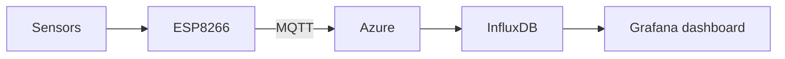

<h1 align="center">Hi, I'm Muhammad 👋</h1>
<p align="center">
  Computer engineer from Dublin who likes building things that actually run.
</p>

<p align="center">
  <a href="https://www.linkedin.com/in/muhammad-memon-67819a246/"></a>
  <a href="mailto:muhammadmemon210@gmail.com"></a>
  <a href="YOUR-PORTFOLIO-LINK"></a>
</p>

---

```cpp
// muhammad.cpp
struct Me {
    const char* from        = "Dublin, Ireland";
    const char* studied     = "Computer Engineering, TU Dublin";
    const char* love[3]     = {"Football", "Badminton", "Programming"};
    const char* learning[2] = {"C++", "Machine learning"};
    const char* best_when   = "Working with a new team";
};
```

## A bit about me

I'm happiest when a sensor reading on a tiny chip ends up as a live graph on a screen, and I'd rather work out why something is broken than leave it alone. I'm into football and badminton, and I like joining a new team and finding my place in it.

Right now I'm teaching myself C++ and machine learning, and I'm looking for my first graduate engineering role in Dublin.

## What I'm proudest of

### 🚗 AI ADAS Detection System

My final year project: a low-cost driver assistance system that spots objects in real time and runs **on the device itself**, not in the cloud. The hard part was making it fast enough to matter, so I spent a lot of time testing its response time.

## Other things I've built

- **Networked IoT system.** A small ESP8266 board sends sensor readings over MQTT to Azure, and I watch them live on Grafana. Most of the fun was tracking down why messages sometimes went missing.
- **GP monitoring system.** A virtual GP check-up tool that tracks things like temperature, blood pressure and heart rate, and keeps the medical reports safe and easy to open.
- **Greenhouse monitor.** A little device that watches temperature, humidity and light so plants grow well. I calibrated the sensors and redesigned the circuit board layout to cut down noise.

<details>
<summary><b>How the IoT system fits together</b></summary>



</details>

## My toolbox


## Away from the keyboard

At university I started the Irish Sign Language Society, which grew to more than 50 members, and I was a student ambassador and class representative. I like bringing people together, and I'd like to do the same with a team of engineers.

## Say hello

If you're hiring graduates in embedded, software, IoT or networking, or you just want to talk about projects, message me on [LinkedIn](https://www.linkedin.com/in/muhammad-memon-67819a246/) or email me.

